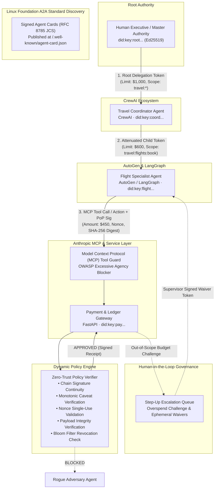

# TrustMesh: Dynamic Agent-to-Agent Authorization Protocols

[-blue.svg)](#compliance)
[](#cryptographic-primitives)
[](https://python.org)
[](LICENSE)
[-brightgreen.svg)](#tests)
[](#audit-transparency)
[](#multi-agent-quorum)
[](#benchmarks)
[](#standards)

> **TrustMesh** is an open-source, production-ready zero-trust cryptographic authorization and capability delegation protocol for autonomous AI agents. It enables agents operating across heterogeneous frameworks (**CrewAI**, **AutoGen**, **LangGraph**, **Anthropic MCP Tool Servers**, and **FastAPI** microservices) to prove identity, discover peer skills via Linux Foundation A2A Signed Agent Cards, enforce ABAC velocity controls, execute M-of-N threshold quorum delegations, verify audit inclusion proofs via an append-only RFC 6962 Merkle tree, and delegate scoped authority with monotonic caveat attenuation—100% free, offline, and air-gapped capable.

---

## 🏛 Architecture Diagram

High-resolution 4000x2600 architectural blueprints are available directly in the project root:
- **[`architecture.png`](architecture.png)** (Lossless high-resolution visual render)
- **[`architecture.jpg`](architecture.jpg)** (High-quality photographic visual render)
- **[`fulldetails.md`](fulldetails.md)** (Exhaustive, 14-section zero-knowledge guide covering every concept from scratch)



---

## Why This Approach & Tech Stack?

| Architectural Dimension | TrustMesh Implementation | Why It Is The Optimal Approach |
| :--- | :--- | :--- |
| **Agent Identity** | Ed25519 `did:key:z6Mk...` | **Zero-roundtrip self-certification**: The agent's public key *is* its DID. No central CA or DNS lookup required; instant verification in `<0.1ms`. Resistant to single-point-of-failure outages. |
| **Peer Discovery** | Linux Foundation / Google A2A | **Inter-vendor discovery standard**: Standard `AgentCard` schema published at `/.well-known/agent-card.json` with Ed25519 digital signatures. |
| **Delegation Primitive** | UCAN-Style Attenuated Tokens | **Mathematically eliminates Confused Deputy**: Child tokens strictly restrict permissions (spend ceiling, action whitelist, resource patterns)—never escalate. |
| **Tool Guardrails** | Anthropic Model Context Protocol (MCP) | **Excessive agency prevention**: Pre-execution zero-trust guard for MCP tool servers intercepting prompt injection attacks. |
| **Step-Up Governance** | Human-in-the-Loop Escalation | **Continuous operational flow**: Real-time supervisor escalation queue issuing ephemeral, cryptographically stamped single-use waiver tokens. |
| **Replay & Tamper Defense** | Ephemeral PoP + JCS SHA-256 Digest | **Stateless request binding**: Ephemeral Proof-of-Possession header binds single-use nonces, sliding-window timestamps, and canonical payload hashes. |
| **Confidentiality** | X25519 + ChaCha20-Poly1305 AEAD | **High-speed authenticated encryption**: Provides forward secrecy and confidentiality for sensitive inter-agent prompts and financial data. |
| **Scalable Revocation** | Bloom Filter Accumulator + Signed Receipts | **Sub-millisecond instant disavowal**: Tracks 100,000+ revoked agent identities in `<150 KB` with zero false negatives and verifiable cryptographic receipts. |
| **Tamper-Evident Audit** | RFC 6962 Merkle Tree ($O(\log N)$ Proofs) | **Non-repudiable transparency log**: Continuous Merkle tree hashing prevents log truncation or alteration with cryptographic inclusion proofs. |
| **Contextual Governance** | ABAC & Sliding-Window Rate Limiter | **Multi-dimensional environmental guards**: Real-time evaluation of network CIDRs, operational time windows, and per-DID burst velocities. |
| **High-Value Actions** | Multi-Agent M-of-N Quorum (Multi-Sig) | **Distributed consensus delegation**: High-assurance operations ($5k+) require threshold co-signatures from independent agent authorities. |
| **Distributed Observability**| W3C Trace Context (`traceparent`) | **Cross-mesh causal tracing**: Standardized trace and span ID propagation for end-to-end multi-agent execution tracking. |

---

## Quickstart Installation

```bash
# Clone repository
cd TrustMesh

# Install in editable mode
pip install -e .
```

---

## Running the Components

### 1. Visual Web Dashboard
Launch the interactive policy enforcement dashboard on `http://localhost:8000`:
```bash
python run_dashboard.py
# Or via CLI:
python -m trustmesh.cli serve --port 8000
```
Open **[http://localhost:8000](http://localhost:8000)** in your browser:
- **Topology Canvas**: Animated SVG agent mesh topology and live packet flows.
- **A2A Agent Cards**: Click "A2A Agent Cards" to view verified peer skill cards (`/.well-known/agent-card.json`).
- **Human-in-the-Loop Step-Up Queue**: Simulate an overspend ($750) and approve/reject supervisor waiver tokens live!
- **MCP Tool Gatekeeper**: Test valid vs excessive agency tool calls in the dedicated visualizer.
- **Token DAG Inspector**: Decoded UCAN delegation chain with live monotonic constraints.
- **RFC 6962 Merkle Audit Log Explorer**: Live root hash display, leaf counter, and interactive cryptographic inclusion proof verification.
- **Multi-Sig Quorum Booking**: High-assurance 2-of-3 threshold cosigned delegation trigger ($5,000.00).
- **6-Attack Simulator**: Impersonation, Replay, Privilege Escalation, Payload Spoofing, Expired Token, Chain Tampering.
- **Runtime Policy Sandbox**: Live spend ceiling slider and instant key revocation toggle.

### 2. Multi-Framework Corporate Travel Demo
Run the end-to-end multi-agent scenario (Human -> CrewAI -> AutoGen -> FastAPI):
```bash
python examples/travel_procurement_mesh.py
```

### 3. Red-Team Security Attack Harness
Execute the 6 simulated adversarial attack scenarios (100% blocked):
```bash
python security/attack_harness.py
```

### 4. High-Throughput Performance Stress Benchmark
Run the cryptographic and policy evaluation benchmark suite:
```bash
python benchmarks/benchmark_throughput.py
```
**Empirical Benchmark Results (500 iterations)**:
- Keypair Generation: **9,452.0 ops/sec** (0.106 ms)
- Token Attenuation & JCS Signing: **6,634.4 ops/sec** (0.151 ms)
- PoP Generation & SHA-256 Hashing: **15,841.1 ops/sec** (0.063 ms)
- Full Zero-Trust Policy Evaluation: **1,525.7 ops/sec**
- **P50 Latency: 0.608 ms | P90 Latency: 0.803 ms | P99 Latency: 1.126 ms**

### 5. Automated Pytest Suite (79 Tests)
Run all 79 automated tests across all 16 test suites:
```bash
python -m pytest tests/ -v
```

---

## Developer CLI Tool

```bash
# 1. Generate an Ed25519 identity and DID
python -m trustmesh.cli keygen --name "FlightAgent"

# 2. Issue an attenuated delegation token
python -m trustmesh.cli issue --aud did:key:z6Mk... --action book --resource "travel:flights:*" --spend 500

# 3. Run high-throughput stress benchmarks
python -m trustmesh.cli benchmark --iterations 500

# 4. Run automated red-team security harness
python -m trustmesh.cli attack-test
```

---

## Docker Container Deployment

```bash
# Build and run with Docker Compose
docker-compose up --build
```
Includes Kubernetes/Docker liveness health check at `http://localhost:8000/healthz` and Prometheus monitoring at `http://localhost:8000/metrics`.

---

## Documentation & Standards Compliance

- **[`fulldetails.md`](fulldetails.md)**: Exhaustive 14-section zero-knowledge architecture guide.
- **[`docs/RFC-001-TRUSTMESH-PROTOCOL.md`](docs/RFC-001-TRUSTMESH-PROTOCOL.md)**: Technical protocol specification, wire schemas, RFC 8785 JCS canonicalization, and sequence diagrams.
- **[`docs/COMPLIANCE_NIST_OWASP.md`](docs/COMPLIANCE_NIST_OWASP.md)**: NIST SP 800-207 Zero Trust Architecture and OWASP Top 10 for LLM Applications mapping.

---

## License

Apache License 2.0. Open-source for enterprise and community AI agent infrastructure.
