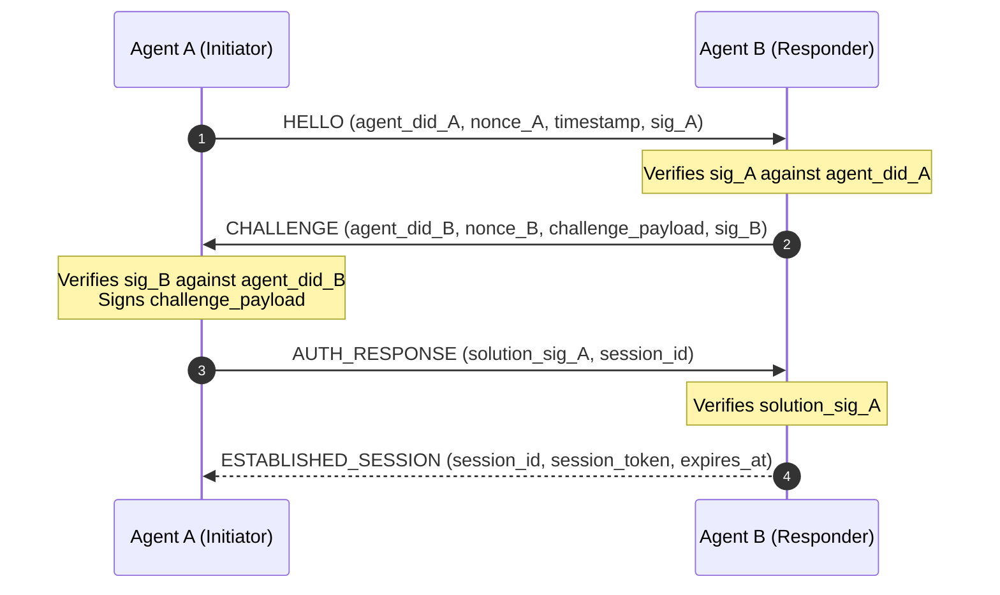
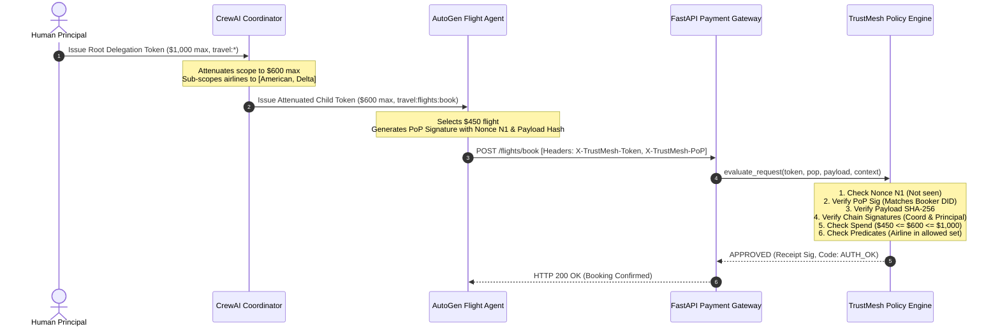
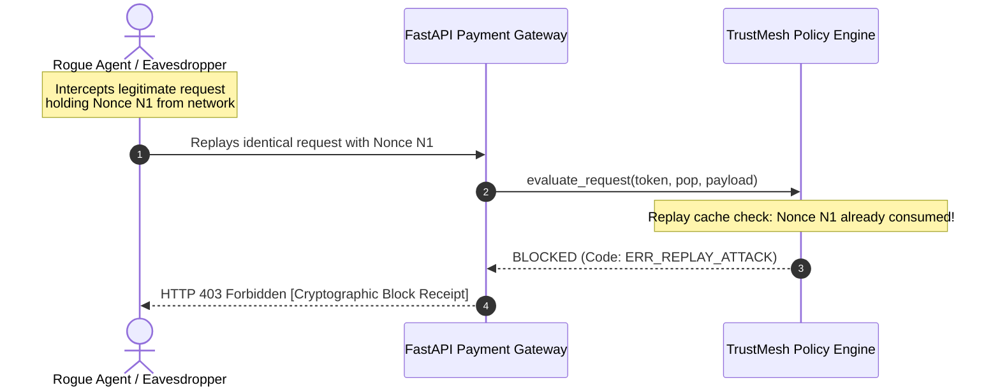

# RFC-001: TrustMesh Dynamic Agent-to-Agent Authorization Protocol

**Status**: Standard Track  
**Category**: AI Security & Infrastructure  
**Version**: 1.0.0  
**Date**: October 2026  
**Authors**: TrustMesh Core Working Group  

---

## 1. Abstract

As autonomous artificial intelligence agents increasingly coordinate across enterprise workflows—purchasing flights, triggering infrastructure mutations, accessing financial ledgers, and invoking external APIs—they cannot rely on static API keys or assume peer agents are benign. **TrustMesh** defines an open, transport-agnostic, zero-trust authorization protocol enabling AI agents from disparate frameworks (e.g., CrewAI, AutoGen, LangGraph, custom HTTP services) to mutually establish cryptographic identity, verify authority, and delegate mathematically attenuated capabilities at runtime without human intervention for each transaction.

---

## 2. Terminology & Core Primitives

- **Principal ($P$)**: An entity (human, organization, or root autonomous system) holding the root trust authority.
- **Agent ($A$)**: An autonomous software process acting on behalf of a Principal or another Agent.
- **`did:key`**: A decentralized, self-certifying identifier format derived directly from an Ed25519 public key (`did:key:z6Mk...`), eliminating external directory lookups or certificate authorities.
- **Capability ($C$)**: An authorized action pattern over a resource namespace (e.g. `action="book"`, `resource="travel:flights:*"`).
- **Caveat ($\gamma$)**: Operational restrictions bound to a capability (e.g., spend ceiling, validity window, parameter whitelist).
- **Delegation Token ($\mathcal{T}$)**: A cryptographically signed token proving that an issuer has granted specified capabilities to an audience agent.
- **Proof-of-Possession ($\text{PoP}$)**: An ephemeral signature produced by the caller binding request parameters, timestamp, and single-use nonce to their private key.

---

## 3. Cryptographic Foundation

### 3.1 Digital Signatures & Keys
All agents utilize the **Ed25519** signature scheme (RFC 8032).
- Key generation: 32-byte private seed $\to$ 32-byte public key.
- Public Key Multicodec Prefix: `0xed01` (varint).
- DID representation: `did:key:z` + $\text{Base58Btc}(\text{0xed01} \,\|\, K_{pub})$.

### 3.2 Canonical JSON (RFC 8785)
All signed objects MUST be serialized according to RFC 8785 (JSON Canonicalization Scheme - JCS) prior to hashing and signing. This guarantees byte-for-byte deterministic representation regardless of programming language or JSON library.

### 3.3 Payload Digest
$$\text{PayloadHash} = \text{SHA-256}(\text{JCS}(\text{Payload}))$$

---

## 4. Capability Delegation & Monotonic Attenuation

### 4.1 Delegation Token Structure
A Delegation Token contains:
$$\mathcal{T} = \langle \text{id}, \text{iss}, \text{aud}, \mathcal{C}, \mathcal{T}_{parent}, t_{issued}, t_{expires}, \text{nonce}, \sigma_{iss} \rangle$$

### 4.2 Monotonic Attenuation Invariant
A child token $\mathcal{T}_{child}$ derived from $\mathcal{T}_{parent}$ must satisfy the **Strict Attenuation Invariant**:
$$\mathcal{T}_{child}.\text{capabilities} \subseteq \mathcal{T}_{parent}.\text{capabilities}$$

Specifically, for each child caveat $\gamma_c$ and matching parent caveat $\gamma_p$:
1. **Spend Limit Monotonicity**:
   $$\gamma_c.\text{max\_spend} \le \gamma_p.\text{max\_spend}$$
2. **Action Monotonicity**:
   $$\gamma_c.\text{allowed\_actions} \subseteq \gamma_p.\text{allowed\_actions}$$
3. **Temporal Monotonicity**:
   $$\mathcal{T}_{child}.t_{expires} \le \mathcal{T}_{parent}.t_{expires}$$
4. **Predicate Restriction**:
   $$\forall k \in \gamma_p.\text{predicates}: \quad \gamma_c.\text{predicates}[k] \subseteq \gamma_p.\text{predicates}[k]$$

Any attempt by a sub-agent to widen scope, increase spend limits, or extend expiration causes the Policy Engine to immediately reject the request with `ERR_PRIVILEGE_ESCALATION`.

---

## 5. Wire Formats & Schemas

### 5.1 Delegation Token JSON Schema
```json
{
  "$schema": "https://json-schema.org/draft/2020-12/schema",
  "title": "DelegationToken",
  "type": "object",
  "required": ["token_id", "iss", "aud", "capabilities", "issued_at", "expires_at", "nonce", "signature"],
  "properties": {
    "token_id": { "type": "string", "format": "uuid" },
    "iss": { "type": "string", "pattern": "^did:key:z[1-9A-HJ-NP-Za-km-z]+$" },
    "aud": { "type": "string", "pattern": "^did:key:z[1-9A-HJ-NP-Za-km-z]+$" },
    "capabilities": {
      "type": "array",
      "items": {
        "type": "object",
        "required": ["resource", "action"],
        "properties": {
          "resource": { "type": "string" },
          "action": { "type": "string" },
          "caveats": {
            "type": "object",
            "properties": {
              "max_spend": { "type": ["number", "null"] },
              "allowed_actions": { "type": ["array", "null"], "items": { "type": "string" } },
              "allowed_resources": { "type": ["array", "null"], "items": { "type": "string" } },
              "expiry": { "type": ["integer", "null"] },
              "predicates": { "type": "object" }
            }
          }
        }
      }
    },
    "parent_token": { "type": ["object", "null"] },
    "issued_at": { "type": "integer" },
    "expires_at": { "type": "integer" },
    "nonce": { "type": "string" },
    "signature": { "type": "string" }
  }
}
```

### 5.2 Proof-of-Possession (PoP) Schema
```json
{
  "$schema": "https://json-schema.org/draft/2020-12/schema",
  "title": "ProofOfPossession",
  "type": "object",
  "required": ["token_id", "agent_did", "action", "resource", "payload_hash", "timestamp", "nonce", "signature"],
  "properties": {
    "token_id": { "type": "string" },
    "agent_did": { "type": "string", "pattern": "^did:key:z[1-9A-HJ-NP-Za-km-z]+$" },
    "action": { "type": "string" },
    "resource": { "type": "string" },
    "payload_hash": { "type": "string", "pattern": "^[a-f0-9]{64}$" },
    "timestamp": { "type": "integer" },
    "nonce": { "type": "string" },
    "signature": { "type": "string" }
  }
}
```

---

## 6. Sequence Diagrams

### 6.1 Mutual Authentication Handshake Protocol


### 6.2 Cross-Framework Delegation & Execution Flow


### 6.3 Attack Rejection Flow (Replay Attack)


---

## 7. Security Threat Model & Mitigation Matrix

| Threat Vector | Attack Description | TrustMesh Mitigation | Error Code |
| :--- | :--- | :--- | :--- |
| **Agent Impersonation** | Rogue agent uses victim DID or forged identity. | Mutual Ed25519 PoP verification; caller DID must equal token audience. | `ERR_IMPERSONATION`, `ERR_AUDIENCE_MISMATCH` |
| **Token Replay** | Attacker replays captured token from network. | Single-use sliding-window nonce cache and $\pm 60\text{s}$ timestamp tolerance. | `ERR_REPLAY_ATTACK`, `ERR_TIMESTAMP_SKEW` |
| **Privilege Escalation** | Agent modifies caveats to expand budget or scope. | Monotonic attenuation mathematical verification down the entire DAG. | `ERR_PRIVILEGE_ESCALATION` |
| **Payload Spoofing** | Attacker alters payment amount or parameters in flight. | JCS canonical SHA-256 digest embedded in signed PoP header. | `ERR_PAYLOAD_TAMPERED` |
| **Stale Token Injection** | Reusing old tokens past authorized task window. | Expiry timestamp strictly checked on all chain links. | `ERR_TOKEN_EXPIRED` |
| **Broken Delegation Chain** | Fabricating an unauthorized middleman issuer. | Unbroken signature continuity check: $\mathcal{T}_i.\text{iss} \equiv \mathcal{T}_{i-1}.\text{aud}$. | `ERR_CHAIN_BROKEN`, `ERR_CHAIN_TAMPERED` |
| **Compromised Agent Key** | Agent credentials compromised during operation. | Instant runtime revocation list checked on every single invocation. | `ERR_AGENT_REVOKED`, `ERR_TOKEN_REVOKED` |
